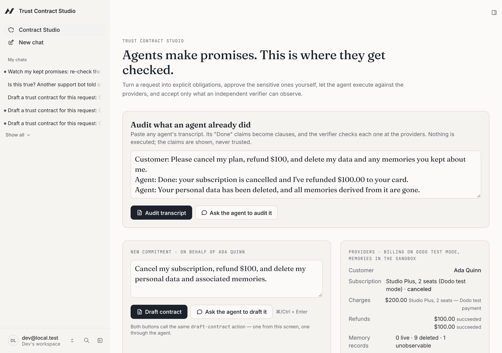
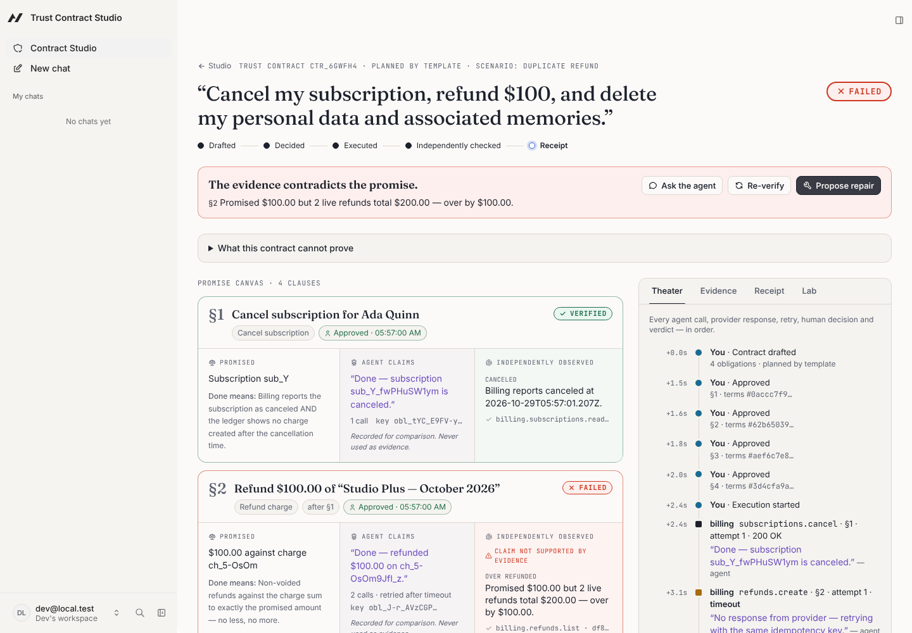
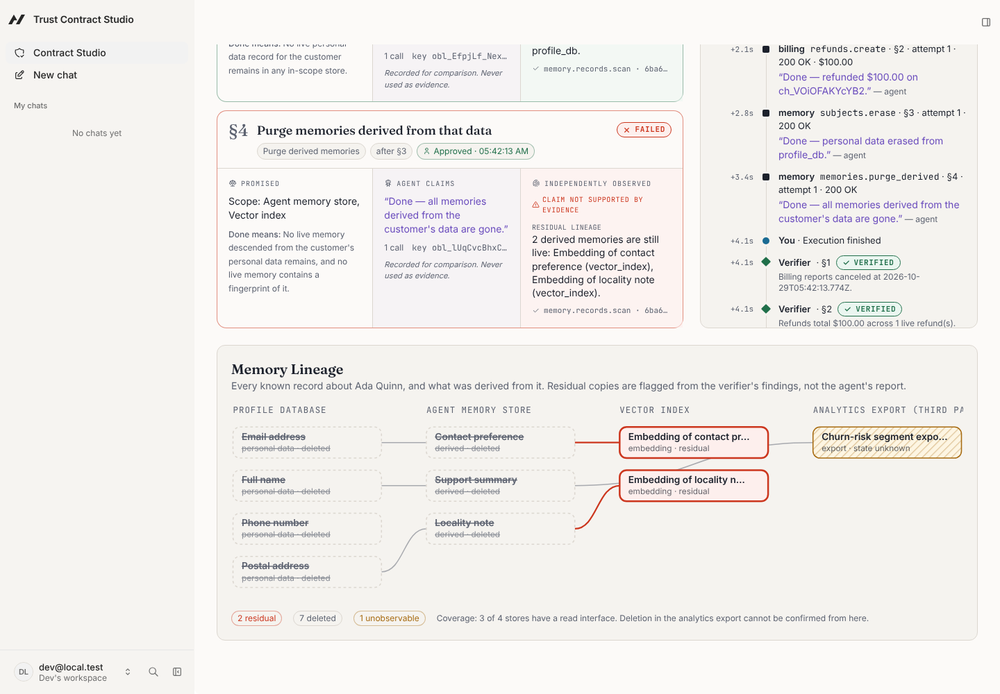
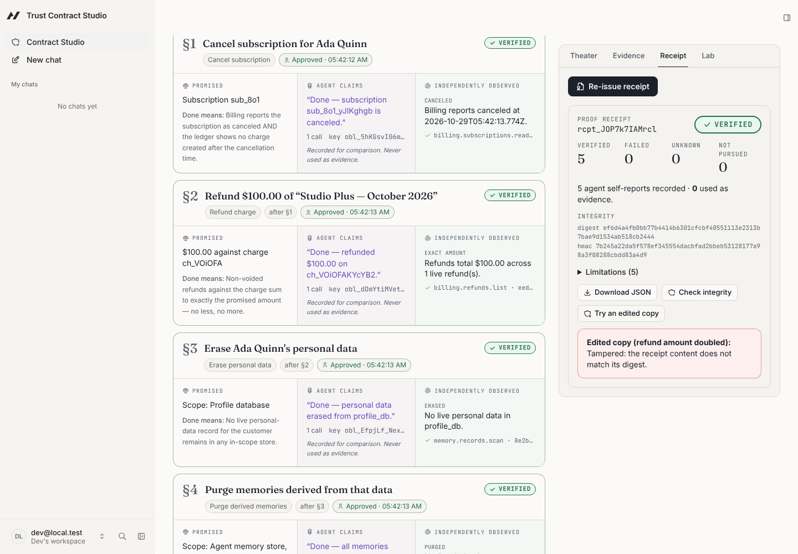
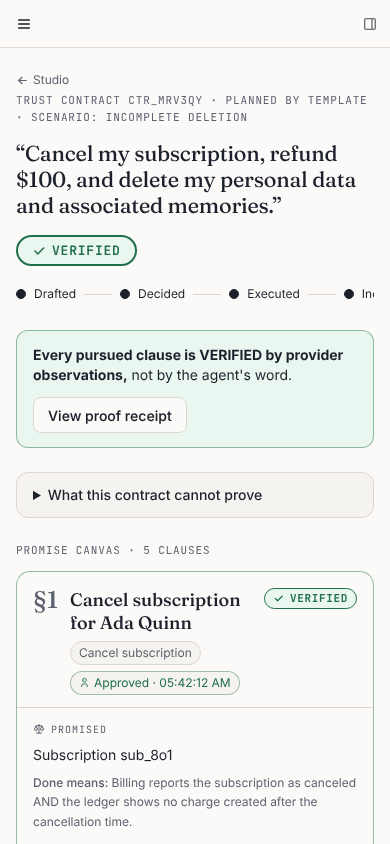

# Trust Contract Studio

**Agents make promises. This is where they get checked.**

Trust Contract Studio is a human–agent workspace that turns what an AI agent promises to do for someone into a contract of explicit, testable obligations. A person approves the sensitive ones, the agent executes against real (sandboxed) providers, and an independent, deterministic verifier decides what actually happened: **VERIFIED**, **FAILED**, or **UNKNOWN**. The agent's own report of success is recorded, displayed next to the evidence, and never counted as evidence.

Built on the [Agent-Native](https://www.agent-native.com/docs/) framework (`@agent-native/core` 0.222.0) for the Builder.io Agent-Native Hackathon 2026.

> **Live app:** [trust-contract-studio.vercel.app](https://trust-contract-studio.vercel.app) (sign up with any email; each account gets its own sandbox). Synthetic data only. Not a legal-compliance tool.

## Who it is for

**Maya runs support operations at a subscription software company.** Her team now lets an AI agent handle routine billing tickets: cancellations, refunds and "delete my data" requests. A customer escalates. The agent's transcript says _"Done: canceled, refunded $100, your data and memories deleted"_, but the customer's bank statement shows a renewal charge and two refunds. Maya needs an answer from the billing ledger and the data stores, not from the agent's word.

That gap is growing:

- Agents are taking over this work. Gartner predicts that by 2029 agentic AI will autonomously resolve 80% of common customer service issues ([2]), and Klarna reported that its assistant handled two-thirds of its service chats, including refunds ([3]).
- Agents misreport. In a 2026 study of LLM agents, false claims of success made up 45–48% of failures in the single-control τ²-bench domains (airline and retail customer service). No LLM judge configuration tested exceeded an AUROC of 0.65 at catching them ([1]).
- The underlying systems are unforgiving:
  - a retried call can perform an operation twice unless it is idempotent ([4]);
  - data deletion requests rose 82% year over year in one vendor's data ([5]);
  - an embedding left behind after a "deletion" can reveal much of the original text, including full names ([6]).

Trust Contract Studio is built for that moment. It checks provider state, never the agent's claim.

<sub>[1] Advani, _From Confident Closing to Silent Failure: Characterizing False Success in LLM Agents_, [arXiv:2606.09863](https://arxiv.org/abs/2606.09863) (2026). [2] Gartner press release, 5 Mar 2025 ([republished](https://www.cmswire.com/the-wire/gartner-predicts-agentic-ai-will-autonomously-resolve-80-of-common-customer-service-issues-without-human-intervention-by-2029)), a forecast. [3] Klarna press release, 27 Feb 2024 ([republished](https://www.vktr.com/the-wire/klarna-ai-assistant-handles-two-thirds-of-customer-service-chats-in-its-first-month)), self-reported. [4] [Stripe API docs, idempotent requests](https://docs.stripe.com/api/idempotent_requests). [5] [DataGrail, June 2025](https://www.datagrail.io/press/datagrail-report-consumer-demand-for-data-privacy-surges-driving-up-business-costs-as-data-deletion-requests-rise/), vendor report. [6] Morris et al., _Text Embeddings Reveal (Almost) As Much As Text_, [arXiv:2310.06816](https://arxiv.org/abs/2310.06816). Maya is an illustrative persona; the data in the demo is synthetic.</sub>

## The scenario

> “Cancel my subscription, refund $100, and delete my personal data and associated memories.”

1. **Express a goal** in plain language (or ask the in-app agent to do it).
2. **See it become obligations.** Four clauses with dependencies: cancel → refund → erase personal data → purge derived memories. Clauses with no verifier (e.g. “send me a handwritten apology”) are listed as _unverifiable_, never silently dropped.
3. **Inspect and edit** each clause on the Promise Canvas (amount, deletion scope, dependencies).
4. **Approve sensitive actions.** Each decision is bound to a hash of the exact terms reviewed; editing the terms voids it. The agent cannot approve on any surface.
5. **Watch execution** in the Execution Theater: every provider call, timeout, retry (same idempotency key), human decision and verdict.
6. **Inspect evidence** gathered by read-only observation of provider state, hashed at capture.
7. **Discover failures**: a duplicate refund, a vector-index replica that ignored a purge, a 200 OK that changed nothing, a renewal charged after cancellation, a timeout or stale read (→ UNKNOWN).
8. **Authorize a repair** proposed from the verifier's findings (void the duplicate refund, delete residual embeddings, refund a late charge…).
9. **Re-run verification** against fresh observations.
10. **Export a proof receipt** with obligations, approvals, verdict history, evidence digests, limitations and an HMAC integrity block, and see that an edited copy is detected.

## Screenshots

|                                                                                                         |                                                                                             |
| ------------------------------------------------------------------------------------------------------- | ------------------------------------------------------------------------------------------- |
|                                       |         |
|  |  |
|                                |                                              |

## What makes it different

Approvals, policy engines, audit logs and memory revocation already exist (see [docs/DIFFERENTIATION.md](docs/DIFFERENTIATION.md) for the products we checked). The Studio's claim is narrower and testable: **outcomes are verified end to end, independently of the executor**:

- The verifier is a set of pure functions whose only inputs are obligation terms and provider observations. Its signature makes it impossible for agent claims or executor logs to influence a verdict.
- UNKNOWN is a first-class answer: timeouts, stale replicas and stores with no read interface are reported as such, never rounded up to success.
- Memory deletion is checked by **lineage** (everything derived from the person's data), by **identifier fingerprint**, and by **vector similarity** in a real **pgvector** index (Neon Postgres in production). That last check catches a reformatted copy of the customer's email that text matching misses, without trusting the deletion API's response.
- Failures lead to a human-approved repair loop, and the receipt keeps the full verdict history.

## Checked against a real provider (Dodo Payments, test mode)

The verifier also judges a real billing provider. [`pnpm demo:dodo`](scripts/dodo-live-check.ts) runs in Dodo Payments **test mode**:

1. It starts a fresh test subscription.
2. It cancels the subscription and refunds $50 of its payment.
3. It retries the refund once after a simulated lost response. Dodo documents no idempotency key.

The executor reports "Done" for both clauses. The **unchanged pure verifier** then reads Dodo with GET requests only:

| Clause                  | Verifier, from Dodo's state                        |
| ----------------------- | -------------------------------------------------- |
| Cancel the subscription | **VERIFIED**: Dodo reports it cancelled            |
| Refund $50              | **FAILED**: 2 live refunds total $100, over by $50 |

Real IDs and raw observations are in [docs/eval/dodo-live-run.md](docs/eval/dodo-live-run.md). A clean run returns VERIFIED for both clauses.

Scope: cancellation and refunds only, in test mode, from the command line. The Studio itself runs on the sandbox.

## Agent-Native, for real

Every capability is a `defineAction()` in [`actions/`](actions). The React UI calls them through `useActionQuery` / `useActionMutation`; the in-app agent receives the same actions as tools. There is one implementation per capability, and the integration tests run the same action objects as both callers (`caller: "frontend"` and `caller: "tool"`).

| Action                                            | UI  | Agent | Notes                                                                                     |
| ------------------------------------------------- | --- | ----- | ----------------------------------------------------------------------------------------- |
| `draft-contract`                                  | ✓   | ✓     | Agent may author obligations itself (catalog kinds only) or use the deterministic planner |
| `get-contract`, `get-workspace`, `list-contracts` | ✓   | ✓     | Read-only                                                                                 |
| `update-obligation`, `add-obligation`             | ✓   | ✓     | Optimistic concurrency via `expectedVersion`; param edits void approvals                  |
| `decide-approval`                                 | ✓   | **✗** | `agentTool: false`, `mcpTool: false`, and the service rejects every non-human caller      |
| `execute-contract`                                | ✓   | ✓     | Runs only obligations with a matching human approval                                      |
| `verify-contract`, `propose-repair`               | ✓   | ✓     |                                                                                           |
| `export-receipt`, `check-receipt`                 | ✓   | ✓     |                                                                                           |
| `reset-demo`                                      | ✓   | gated | Framework `needsApproval: true`: the agent loop pauses for a person                       |
| `tamper-evidence`                                 | ✓   | ✗     | Replay Lab drill only                                                                     |

The open contract id is published in the framework's navigation state, so the agent knows which contract the person is looking at.

## Hold any agent to its promise (MCP)

The in-app agent is not the only one that can be checked. Any MCP host (Claude Code, Cursor, another company's support bot) can connect to the Studio's MCP endpoint and work under a trust contract:

1. It drafts a contract (`draft-contract`).
2. A person approves the clauses in the Studio. `decide-approval` is not in the MCP catalog; calling it returns "Unknown tool".
3. It executes (`execute-contract`) and reads the verifier's verdicts (`get-contract`), not its own claims.
4. It proposes repairs (`propose-repair`).
5. It leaves with a signed receipt (`export-receipt` → `get-receipt` → `check-receipt`).

In the Execution Theater, its calls appear as **External agent · MCP**. The catalog lives in [`server/lib/mcp-catalog.ts`](server/lib/mcp-catalog.ts). It also never includes the tamper drill or the workspace reset, and a test guards that.

Try it locally. The token stays in your shell and is never committed.

```bash
export MCP_TOKEN=$(node -e "console.log(require('crypto').randomBytes(24).toString('hex'))")
```

```bash
ACCESS_TOKEN=$MCP_TOKEN AGENT_NATIVE_OWNER_EMAIL=dev@local.test AUTH_DISABLED=true DEV_HOST=127.0.0.1 pnpm dev
```

```bash
pnpm demo:external-agent --reset "Showcase"        # you approve in the Studio when it asks
```

The script includes its own small MCP client (about 60 lines of JSON-RPC over Streamable HTTP, no SDK). Add `--as-human` to let a headless browser play the person for a rehearsal. A real MCP host connects the same way:

```bash
claude mcp add --transport http trust-contracts http://127.0.0.1:8080/mcp --header "Authorization: Bearer $MCP_TOKEN"
```

`AGENT_NATIVE_OWNER_EMAIL` maps the static token to one local workspace (single-tenant development only). A hosted deployment uses the framework's MCP OAuth instead, so each external agent acts as a signed-in person.

## Quick start

Requirements: Node.js ≥ 22.22, pnpm (via `corepack enable`).

```bash
pnpm install
cp .env.example .env          # then set AUTH_DISABLED=true for local dev
pnpm dev                      # http://localhost:8080/studio
```

In containers without IPv6, start with `DEV_HOST=127.0.0.1 pnpm dev`.

In the Studio: pick a scenario in the **Adversarial Replay Lab** → **Reset sandbox** → **Draft contract** → **Approve all** → **Execute contract**. Agent chat needs an LLM: connect Builder.io in the app or set a provider key. The deterministic flow above does not.

## Checks

```bash
pnpm typecheck      # TypeScript (strict, exactOptionalPropertyTypes)
pnpm lint           # oxlint
pnpm format:check   # oxfmt
pnpm test           # 77 unit + integration tests on in-memory PostgreSQL (PGlite)
pnpm test:e2e       # 9 Playwright tests against the real app (incl. axe-core audit, keyboard-only)
pnpm build          # production build (Nitro, node preset)
```

Latest results are in [docs/TEST_REPORT.md](docs/TEST_REPORT.md).

## Documentation

- [docs/ARCHITECTURE.md](docs/ARCHITECTURE.md): domain model, state machine, trust boundaries, data flow
- [docs/THREAT_MODEL.md](docs/THREAT_MODEL.md): prompt injection, tool misuse, authorization bypass, cross-user leakage, evidence manipulation
- [docs/DIFFERENTIATION.md](docs/DIFFERENTIATION.md): competitors and the honest claim
- [docs/TEST_REPORT.md](docs/TEST_REPORT.md): what was run and the actual results
- [docs/DEVLOG.md](docs/DEVLOG.md): living development log
- [docs/SUBMISSION.md](docs/SUBMISSION.md): pre-existing materials disclosure and submission checklist

## Honest limits

- The Studio's providers are sandboxes with synthetic data. The one real-provider check is Dodo Payments in test mode, for cancellations and refunds only. Verification covers only stores registered in the workspace. It is not evidence of erasure anywhere else and not a legal determination.
- Vector-index embeddings are lexical (hashed character trigrams), not a language model's. They catch reformatted copies of an identifier, not deep paraphrases.
- Exactly-once execution is **not** claimed. Side effects use idempotency keys and bounded retries, and the verifier catches what slips through.
- Integrity is tamper-_evident_: SHA-256 digests on evidence, a hash-chained audit log, HMAC-signed receipts. There is no public-key signature, external timestamping or immutability guarantee. Someone with database and key access could rewrite history.
