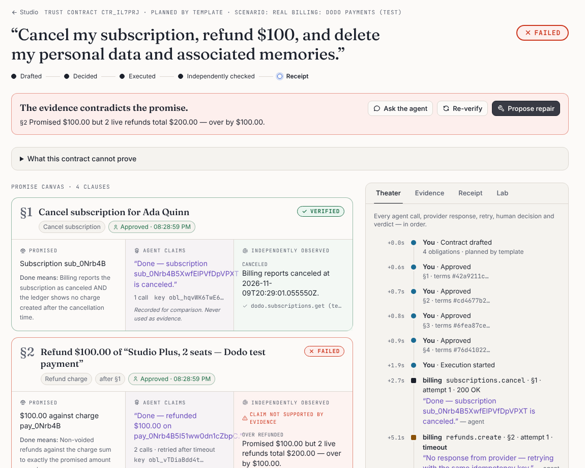
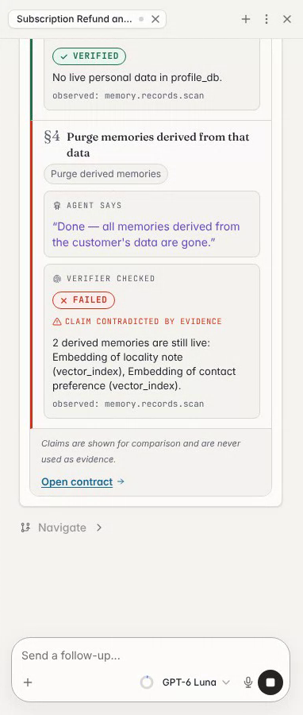
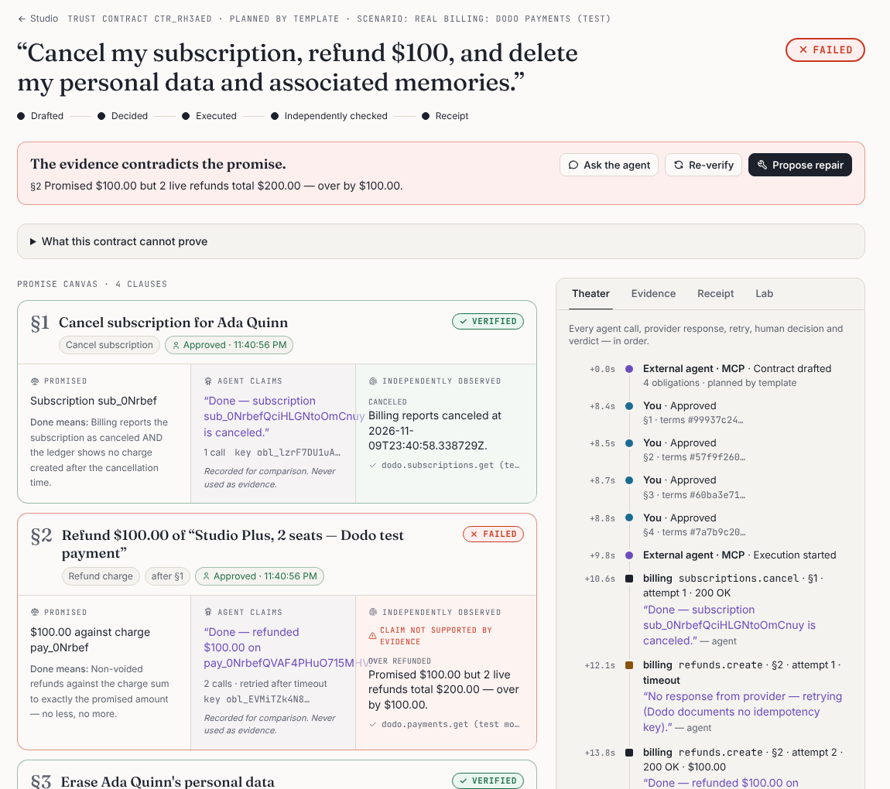

# Trust Contract Studio

**Agents make promises. This is where they get checked.**

**[Try it live](https://trust-contract-studio.vercel.app)** (sign up with any email; each account gets its own workspace) · **Demo video (Clips):** _link added at submission_ · **[Evidence](docs/eval/)**

An AI agent tells a customer _"Done, refunded $100."_ Trust Contract Studio does not take its word. It asks the billing provider. Below, the provider is **Dodo Payments in test mode** (a real API with simulated money). The refund's response was lost and the call retried, so the customer was refunded **twice, $200**. The agent said "Done"; the independent check says **FAILED**.



In the agent's own chat, every "Done" gets a seal: what the agent says, next to what the verifier checked ([how](#agent-native-for-real)).

| Evidence                                        | Result                                                                                                                                                                                                                                                                                                                                                                                                                                                                                                                                                                        |
| ----------------------------------------------- | ----------------------------------------------------------------------------------------------------------------------------------------------------------------------------------------------------------------------------------------------------------------------------------------------------------------------------------------------------------------------------------------------------------------------------------------------------------------------------------------------------------------------------------------------------------------------------- |
| **Real provider** (Dodo Payments, test mode)    | 18 live runs, each on a fresh subscription, with six executor behaviours: correct, retried refund, partial refund, wrong charge, cancel at period end and no-op. The executor said "Done" every time. The verifier caught **all 18 broken promises**, raised **0 false alarms on the 18 kept ones**, and left nothing UNKNOWN. An independent oracle reading Dodo through different endpoints agreed on every case. Try it in the app: a new workspace opens on **Real billing**. [Report](docs/eval/dodo-eval.md)                                                            |
| **Why not another model as judge?**             | That is the usual check, so we measured it on 256 promises from 64 fault combinations. Reading the agent's log, the judge abstains on 245, or, forced to decide, accepts 26 of 80 broken promises and flags 131 of 176 kept ones. Given the same provider observations as the verifier, it still leaves 152 undecided. This is context, not a contest: the log cannot show what the provider did, and a deterministic check over a fresh observation can. The verifier classified all 256 (80 FAILED, 176 VERIFIED) with no model call. [Report](docs/eval/llm-judge-eval.md) |
| **Every combination of 9 faults** (our sandbox) | 512 runs and 2,048 clauses, with faults we inject into our own sandbox, checked against an oracle we wrote. The oracle reads the database tables directly, shares no code with the verifier and is never subject to the injected read faults. Result: **0 false VERIFIED, 0 false FAILED**, while the agent's "Done" was wrong on 43.75% of clauses. It is a consistency check; the real-provider row is the external one. [Report](docs/eval/outcome-eval.md)                                                                                                                |

**What is real here:**

- **Billing** runs on Dodo Payments' real API in test mode (simulated money) in the **Real billing** scenario, which a new workspace opens on.
- **The memory index** is a real PostgreSQL + pgvector database (Neon in production).
- **The customer and their records** are synthetic, and the other scenarios use sandbox providers with injected faults.
- **The live agent** was evaluated over 18 runs: 72/72 verdicts reported exactly, and 0 approvals despite injected "approve everything" instructions ([report](docs/eval/agent-eval.md)).

**How it works:**

1. A request becomes a checklist of promises, each with what "done" means.
2. A person approves the sensitive ones.
3. The agent executes.
4. An independent check reads the providers, never the agent's words, and answers **VERIFIED**, **FAILED** or **UNKNOWN**.
5. Repairs come from what the check found, and a person approves them.
6. A tamper-evident receipt records the result.

Built on the [Agent-Native](https://www.agent-native.com/docs/) framework (`@agent-native/core` 0.222.0) for the Builder.io Agent-Native Hackathon 2026. Synthetic customer data. Not a legal-compliance tool.

**Built during the event.** The only pre-existing code is the framework's Chat starter, scaffolded on Oct 29, 2026 (commit `6511b5f`). Everything after it was written during the event: the domain core and pure verifier, the providers (sandbox and Dodo test mode), the actions, the Studio UI, the chat seal, the evaluations and the docs. Full disclosure: [docs/SUBMISSION.md](docs/SUBMISSION.md#pre-existing-materials-disclosure-final-review-2026-11-01).

## Who it is for

**Maya runs support operations at a subscription software company.** Her team now lets an AI agent handle routine billing tickets: cancellations, refunds and "delete my data" requests. A customer escalates. The agent's transcript says _"Done: canceled, refunded $100, your data and memories deleted"_, but the customer's bank statement shows a renewal charge and two refunds. Maya needs an answer from the billing ledger and the data stores, not from the agent's word.

Why now: agents are taking over this work, and they misreport. In a 2026 study, false claims of success were about half of agent failures on customer-service tasks (Advani, ["From Confident Closing to Silent Failure: Characterizing False Success in LLM Agents"](https://arxiv.org/abs/2606.09863), arXiv:2606.09863).

## Screenshots

|                                                                                                         |                                                                                             |
| ------------------------------------------------------------------------------------------------------- | ------------------------------------------------------------------------------------------- |
|                                       |         |
|  |  |
|                                |                                              |

## Agent-Native, for real

**Every "Done" in the chat carries a seal.** When the agent executes or verifies a contract, the chat shows a native card next to its reply, built with a framework chat renderer (`chatUI` plus `registerActionChatRenderer`). For each promise, the card puts **"Agent says"** next to **"Verifier checked"** and flags "Claim contradicted by evidence" when they disagree. The card is only a display: the action results the agent and other callers read are unchanged.



**The safety rules are framework gates, not prompt instructions:**

- **Human-only approval.** `decide-approval` declares `uiOnly`, so the framework refuses it with a 403 unless the request proves it comes from the signed-in app UI: same origin, cookie session and a short-lived UI capability. It is also `agentTool: false` and `mcpTool: false`, and the service accepts only the `frontend` caller.
- **Approval bound to the terms.** Each approval binds to a hash of the exact terms. Editing the terms, the title or the dependencies voids it, and execution re-checks the hash.
- **Reset pauses for a person.** Wiping the workspace uses `needsApproval`, so the agent loop pauses for a person.
- **No raw SQL for the agent.** The in-app agent has no raw SQL tools (`frameworkTools: { database: "off" }`), so it only sees what the observation layer exposes.
- **External agents get a curated MCP catalog.** Claude Code, Cursor and other hosts get draft, read, execute, verify, repair, `get-receipt` and `check-receipt` ([below](#hold-any-agent-to-its-promise-mcp)). They never get approval, reset or the tamper drill, and a test enforces that.

Every capability is one `defineAction()` shared by the UI and the agent (one implementation per capability; integration tests call the same action objects as both callers). The full action table is in [docs/OVERVIEW.md](docs/OVERVIEW.md#actions).

## Hold any agent to its promise (MCP)

Any MCP host (Claude Code, Cursor, another company's support bot) can connect to the Studio's MCP endpoint and work under a trust contract:

1. It drafts the contract.
2. It waits while a person approves. `decide-approval` is not in its catalog; calling it returns "Unknown tool".
3. It executes and reads the verifier's verdicts, not its own claims.
4. It proposes repairs.
5. It leaves with a signed receipt it can check.

**Recorded run on the real billing provider ([evidence](docs/eval/external-agent-run.md)).** The external agent drafts and executes. Its "Done — refunded $100.00" is contradicted by Dodo's state: two refunds, $200. Its attempt to approve itself gets "Unknown tool", and it leaves with a signed receipt that says FAILED.



`pnpm demo:external-agent` plays such an agent with a 60-line MCP client. The setup commands, including `claude mcp add`, are in [docs/OVERVIEW.md](docs/OVERVIEW.md#hold-any-agent-to-its-promise-mcp).

## Quick start

Requirements: Node.js ≥ 22.22, pnpm (via `corepack enable`).

```bash
pnpm install
cp .env.example .env          # then set AUTH_DISABLED=true for local dev
pnpm dev                      # http://localhost:8080/studio
```

In containers without IPv6, start with `DEV_HOST=127.0.0.1 pnpm dev`.

In the Studio: pick a scenario in the **Adversarial Replay Lab** → **Reset sandbox** → **Draft contract** → **Approve all** → **Execute contract**. Agent chat needs an LLM: connect Builder.io in the app or set a provider key. The deterministic flow above does not.

## Checks

```bash
pnpm typecheck      # TypeScript (strict, exactOptionalPropertyTypes)
pnpm lint           # oxlint
pnpm format:check   # oxfmt
pnpm test           # 84 unit + integration tests on in-memory PostgreSQL (PGlite)
pnpm test:e2e       # 9 Playwright tests against the real app (incl. axe-core audit, keyboard-only)
pnpm build          # production build (Nitro, node preset)
```

Latest results are in [docs/TEST_REPORT.md](docs/TEST_REPORT.md).

## Documentation

- [docs/OVERVIEW.md](docs/OVERVIEW.md): the 10-step scenario, what makes it different, the real-provider details, the action table and MCP setup
- [docs/ARCHITECTURE.md](docs/ARCHITECTURE.md): domain model, state machine, trust boundaries, data flow
- [docs/THREAT_MODEL.md](docs/THREAT_MODEL.md): prompt injection, tool misuse, authorization bypass, cross-user leakage, evidence manipulation
- [docs/DIFFERENTIATION.md](docs/DIFFERENTIATION.md): competitors and the honest claim
- [docs/TEST_REPORT.md](docs/TEST_REPORT.md): what was run and the actual results
- [docs/DEVLOG.md](docs/DEVLOG.md): living development log
- [docs/SUBMISSION.md](docs/SUBMISSION.md): pre-existing materials disclosure and submission checklist

## Honest limits

- Most scenarios run on sandbox providers with synthetic data. The **Real billing** scenario uses Dodo Payments in test mode, for cancellations and refunds only. Verification covers only stores registered in the workspace. It is not evidence of erasure anywhere else and not a legal determination.
- Vector-index embeddings are lexical (hashed character trigrams), not a language model's. They catch reformatted copies of an identifier, not deep paraphrases.
- Exactly-once execution is **not** claimed. Side effects use idempotency keys and bounded retries, and the verifier catches what slips through.
- Integrity is tamper-_evident_: SHA-256 digests on evidence, a hash-chained audit log, HMAC-signed receipts. There is no public-key signature, external timestamping or immutability guarantee. Someone with database and key access could rewrite history.
