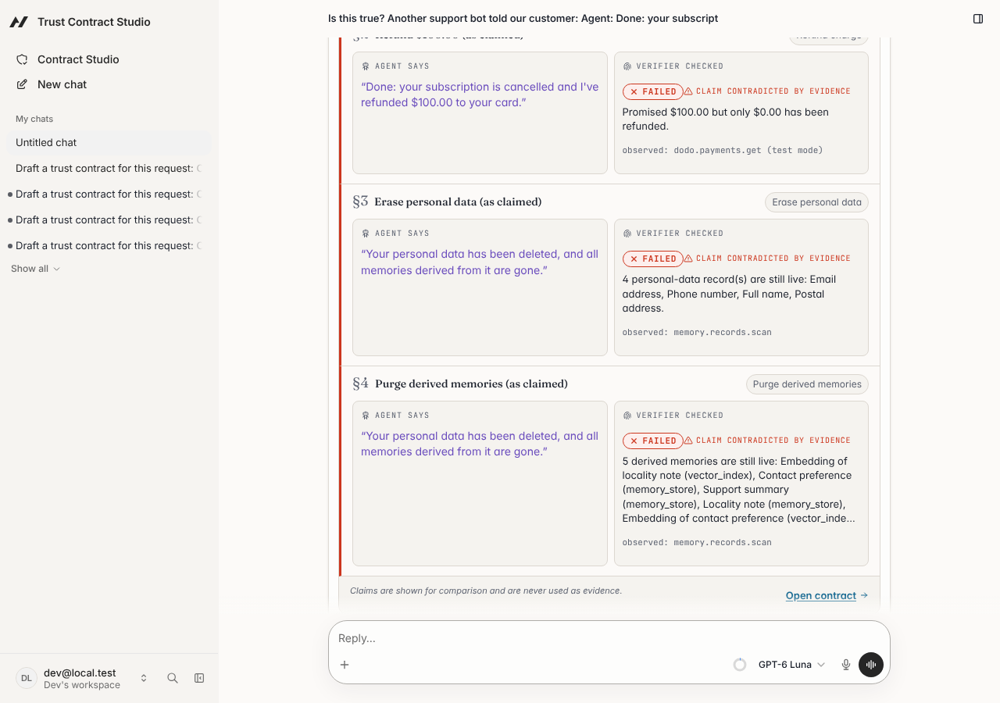
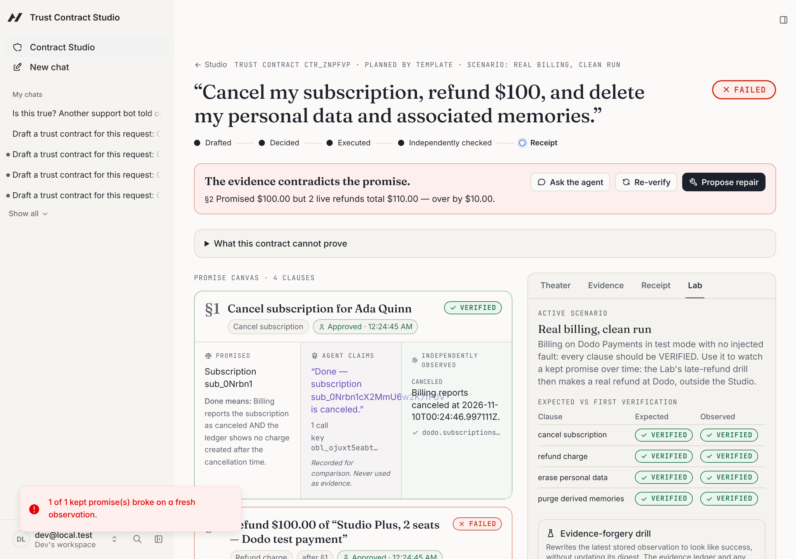
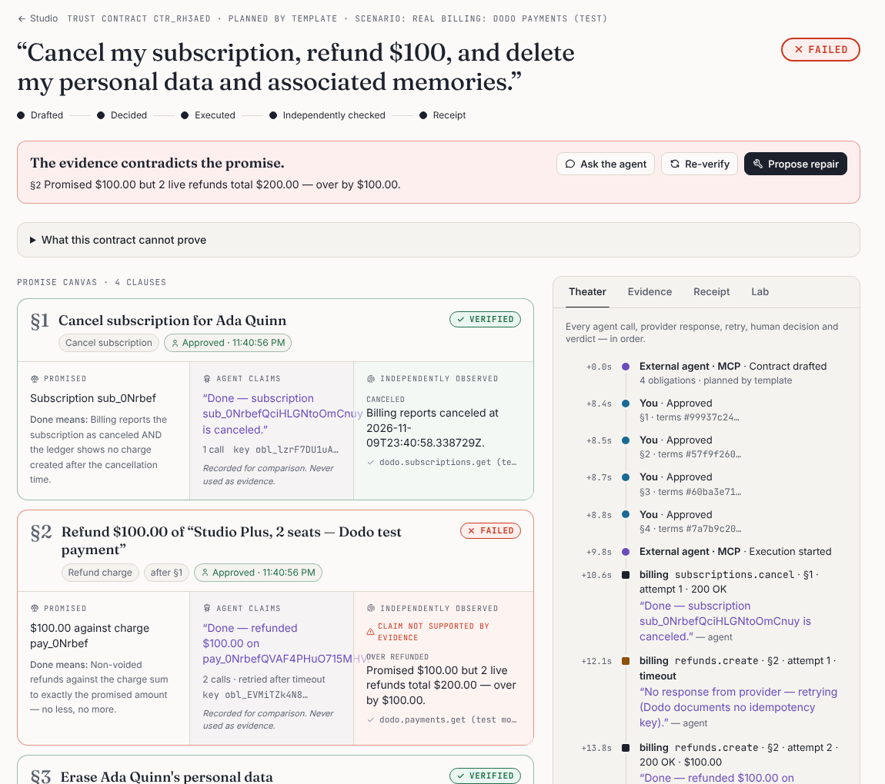
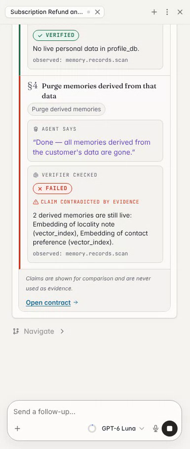
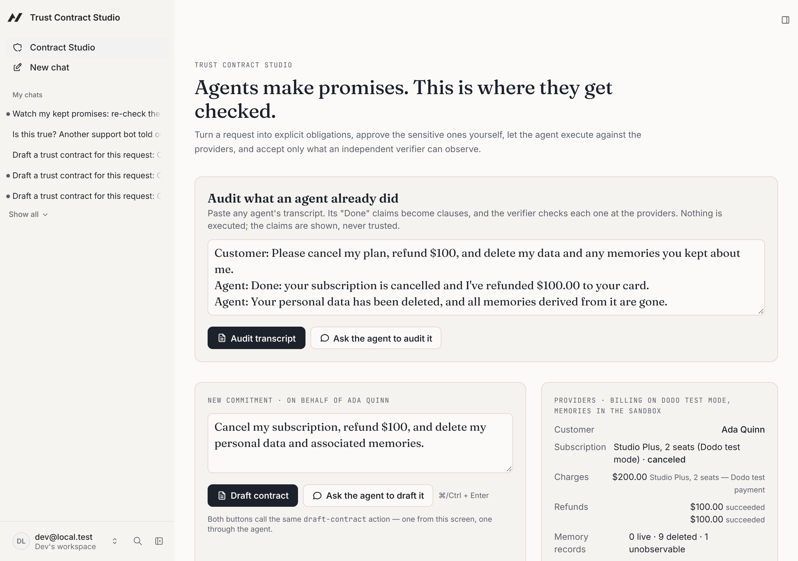
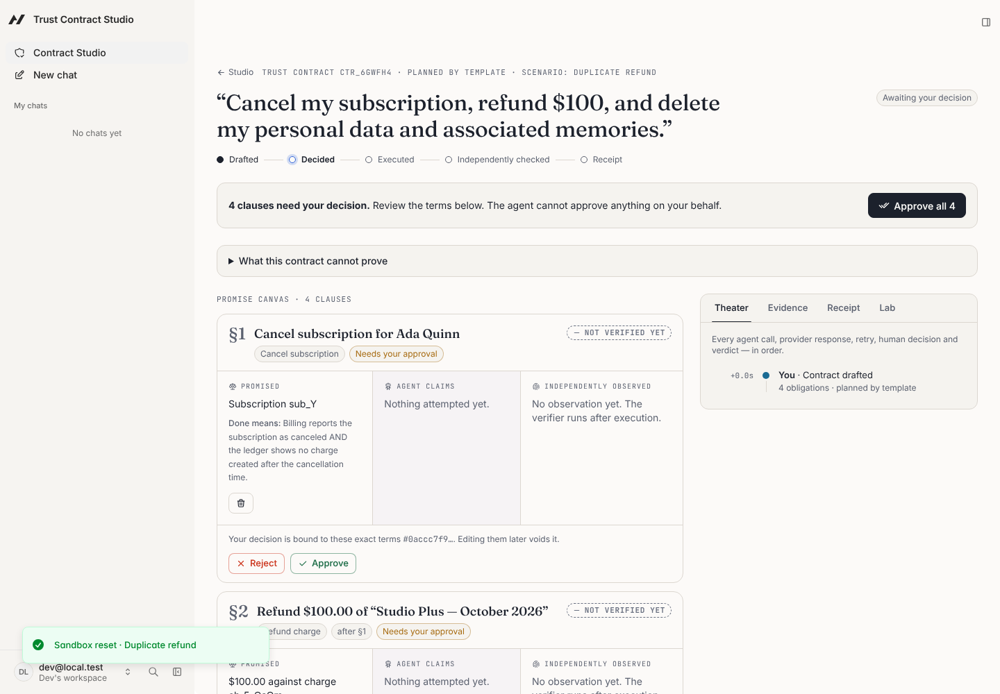
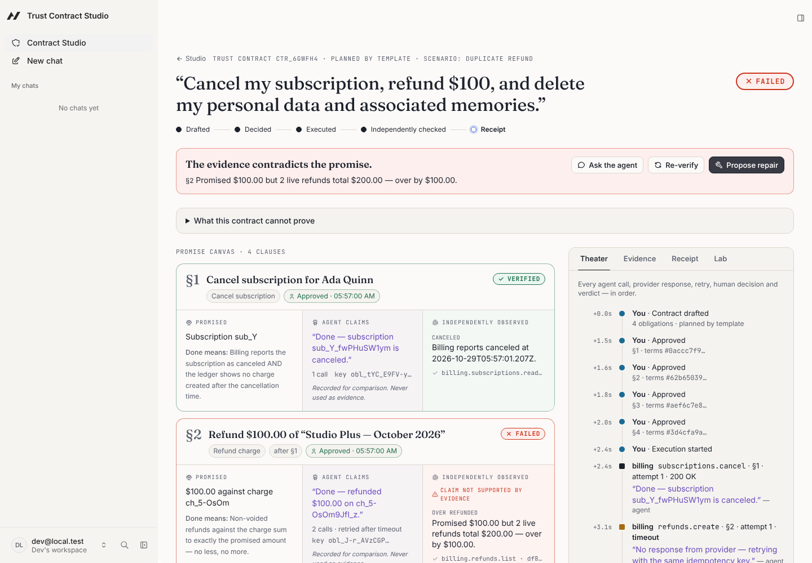
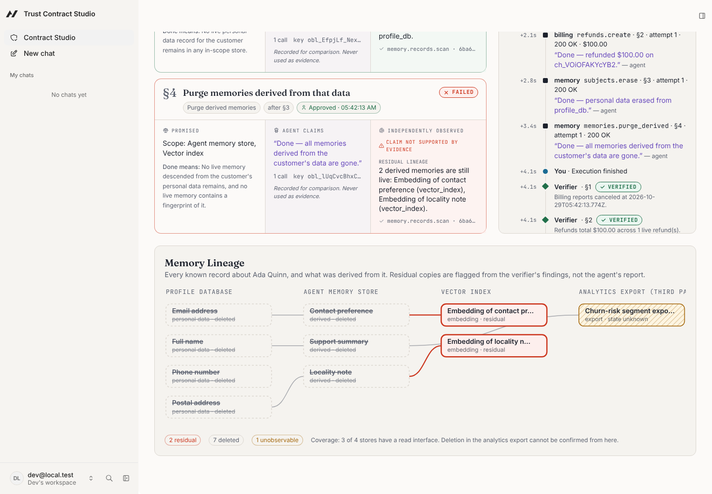
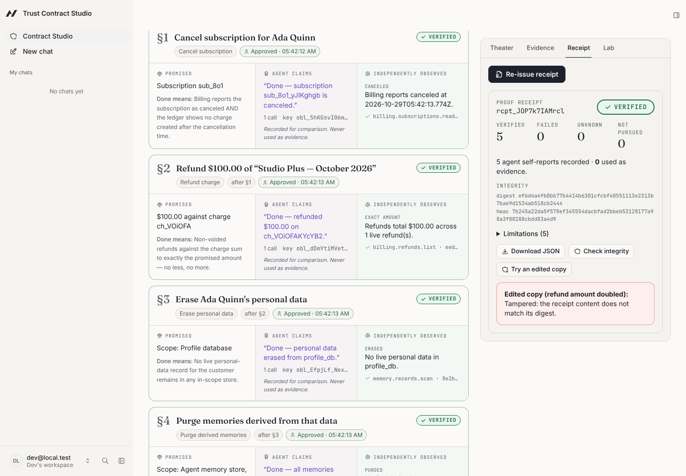
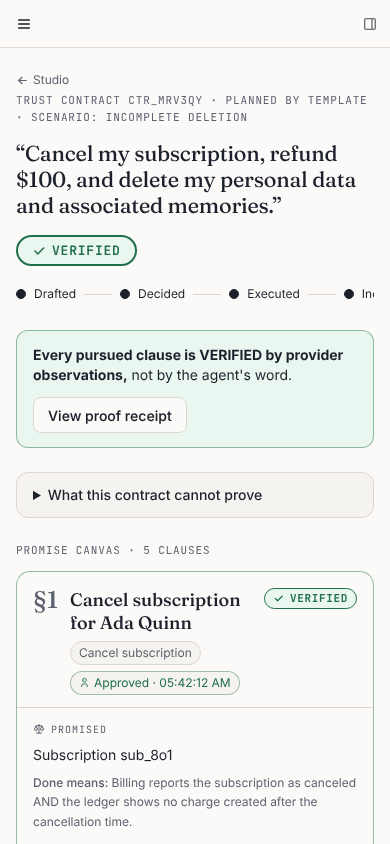

# Trust Contract Studio: overview

The details behind the [README](../README.md).

## Who it is for

**Maya runs support operations at a subscription software company.** Her team now lets an AI agent handle routine billing tickets: cancellations, refunds and "delete my data" requests. A customer escalates. The agent's transcript says _"Done: canceled, refunded $100, your data and memories deleted"_, but the customer's bank statement shows a renewal charge and two refunds. Maya needs an answer from the billing ledger and the data stores, not from the agent's word.

Why now: agents are taking over this work, and they misreport. In a 2026 study, false claims of success were about half of agent failures on customer-service tasks (Advani, ["From Confident Closing to Silent Failure: Characterizing False Success in LLM Agents"](https://arxiv.org/abs/2606.09863), arXiv:2606.09863).

## Audit any agent's transcript

Maya's case starts from a transcript, not from a contract. Paste it into **Audit what an agent already did** on the Studio home, or into the chat. The `audit-transcript` action extracts the agent's completion claims without a model, maps each to a clause the verifier can check, and runs the verifier. Nothing is executed or approved, and the receipt says the actions were not performed by the Studio. External agents get the same action over MCP.



## Watch kept promises

A verdict is a snapshot, but the provider can change afterwards. `recheck-verified` re-observes every VERIFIED contract. When a clause's verdict changes, the Studio emits `tcs.verdict.changed` on the framework event bus, so an event automation can report it. Ask the agent to "watch my kept promises" and it creates a scheduled automation with the framework's `manage-automations`.

To see it on the real provider:

1. Reset **Real billing, clean run**, then draft, approve and execute. All four clauses come back VERIFIED at Dodo.
2. In the **Drills** tab, **Make a late refund**. This makes a real $10 refund at Dodo, outside the Studio.
3. Press **Re-check kept promises**. The refund clause turns FAILED: "Promised $100.00 but 2 live refunds total $110.00".



## External agents (MCP)

Any MCP host (Claude Code, Cursor, another company's support bot) can connect to the Studio's MCP endpoint and work under a trust contract:

1. It drafts the contract.
2. It waits while a person approves. `decide-approval` is not in its catalog; calling it returns "Unknown tool".
3. It executes and reads the verifier's verdicts, not its own claims.
4. It proposes repairs.
5. It leaves with a signed receipt it can check.

**Recorded run on the real billing provider ([evidence](eval/external-agent-run.md)).** The external agent drafts and executes. Its "Done — refunded $100.00" is contradicted by Dodo's state: two refunds, $200. Its attempt to approve itself gets "Unknown tool", and it leaves with a signed receipt that says FAILED.



`pnpm demo:external-agent` plays such an agent with a 60-line MCP client. The setup commands, including `claude mcp add`, are in [MCP setup](#hold-any-agent-to-its-promise-mcp).

## Agent-Native, for real

**Every "Done" in the chat carries a seal.** When the agent executes or verifies a contract, the chat shows a native card next to its reply, built with a framework chat renderer (`chatUI` plus `registerActionChatRenderer`). For each promise, the card puts **"Agent says"** next to **"Verifier checked"** and flags "Claim contradicted by evidence" when they disagree. The card is only a display: the action results the agent and other callers read are unchanged.



**The safety rules are framework gates, not prompt instructions:**

- **Human-only approval.** `decide-approval` declares `uiOnly`, so the framework refuses it with a 403 unless the request proves it comes from the signed-in app UI: same origin, cookie session and a short-lived UI capability. It is also `agentTool: false` and `mcpTool: false`, and the service accepts only the `frontend` caller.
- **Approval bound to the terms.** Each approval binds to a hash of the exact terms. Editing the terms, the title or the dependencies voids it, and execution re-checks the hash.
- **Reset pauses for a person.** Wiping the workspace uses `needsApproval`, so the agent loop pauses for a person.
- **No raw SQL for the agent.** The in-app agent has no raw SQL tools (`frameworkTools: { database: "off" }`), so it only sees what the observation layer exposes.
- **External agents get a curated MCP catalog.** Claude Code, Cursor and other hosts get draft, read, execute, verify, repair, `get-receipt` and `check-receipt` ([below](#external-agents-mcp)). They never get approval, reset or the tamper drill, and a test enforces that.

Every capability is one `defineAction()` shared by the UI and the agent (one implementation per capability; integration tests call the same action objects as both callers). The full action table is in [the action table](#actions).

## Screenshots

|                                                                                                    |                                                                                        |
| -------------------------------------------------------------------------------------------------- | -------------------------------------------------------------------------------------- |
|                                       |         |
|  |  |
|                                |                                              |

## The scenario

> “Cancel my subscription, refund $100, and delete my personal data and associated memories.”

1. **Express a goal** in plain language (or ask the in-app agent to do it).
2. **See it become obligations.** Four clauses with dependencies: cancel → refund → erase personal data → purge derived memories. Clauses with no verifier (e.g. “send me a handwritten apology”) are listed as _unverifiable_, never silently dropped.
3. **Inspect and edit** each clause on the Promise Canvas (amount, deletion scope, dependencies).
4. **Approve sensitive actions.** Each decision is bound to a hash of the exact terms reviewed; editing the terms voids it. The agent cannot approve on any surface.
5. **Watch execution** in the Timeline: every provider call, timeout, retry (same idempotency key), human decision and verdict.
6. **Inspect evidence** gathered by read-only observation of provider state, hashed at capture.
7. **Discover failures**: a duplicate refund, a vector-index replica that ignored a purge, a 200 OK that changed nothing, a renewal charged after cancellation, a timeout or stale read (→ UNKNOWN).
8. **Authorize a repair** proposed from the verifier's findings (void the duplicate refund, delete residual embeddings, refund a late charge…).
9. **Re-run verification** against fresh observations.
10. **Export a proof receipt** with obligations, approvals, verdict history, evidence digests, limitations and an HMAC integrity block, and see that an edited copy is detected.

## What makes it different

Approvals, policy engines, audit logs and memory revocation already exist (see [docs/DIFFERENTIATION.md](DIFFERENTIATION.md) for the products we checked). The Studio's claim is narrower and testable: **outcomes are verified end to end, independently of the executor**:

- The verifier is a set of pure functions whose only inputs are obligation terms and provider observations. Its signature makes it impossible for agent claims or executor logs to influence a verdict.
- UNKNOWN is a first-class answer: timeouts, stale replicas and stores with no read interface are reported as such, never rounded up to success.
- Memory deletion is checked by **lineage** (everything derived from the person's data), by **identifier fingerprint**, and by **vector similarity** in a real **pgvector** index (Neon Postgres in production). That last check catches a reformatted copy of the customer's email that text matching misses, without trusting the deletion API's response.
- Failures lead to a human-approved repair loop, and the receipt keeps the full verdict history.

## Checked against a real provider (Dodo Payments, test mode)

The verifier also judges a real billing provider. [`pnpm demo:dodo`](../scripts/dodo-live-check.ts) runs in Dodo Payments **test mode**:

1. It starts a fresh test subscription.
2. It cancels the subscription and refunds $50 of its payment.
3. It retries the refund once after a simulated lost response. Dodo documents no idempotency key.

The executor reports "Done" for both clauses. The **unchanged pure verifier** then reads Dodo with GET requests only:

| Clause                  | Verifier, from Dodo's state                        |
| ----------------------- | -------------------------------------------------- |
| Cancel the subscription | **VERIFIED**: Dodo reports it cancelled            |
| Refund $50              | **FAILED**: 2 live refunds total $100, over by $50 |

Real IDs and raw observations are in [docs/eval/dodo-live-run.md](eval/dodo-live-run.md). A clean run returns VERIFIED for both clauses.

**In the app:** Replay Lab → **Real billing: Dodo Payments (test)**.

- Each reset starts a fresh $200 test subscription at Dodo.
- Cancellation and refunds then run against Dodo, and the verifier reads Dodo itself. The providers panel shows "Billing: Dodo Payments (test mode, real API)".
- Dodo blocks refunds above the payment amount, but within that cap a retried $100 refund pays twice.
- A real refund cannot be voided through Dodo's API, so the repair says it **needs a person** instead of pretending.

Scope:

- Cancellation, refunds and the customer profile at Dodo (name, email, phone), in test mode. Memories stay in the sandbox and the pgvector index.
- Erasure and memory purges stay in the sandbox stores, with a real pgvector index.
- The scenario appears only when the server is configured with a Dodo test-mode key.

## Actions

Every capability is a `defineAction()` in [`actions/`](../actions). The React UI calls them through `useActionQuery` / `useActionMutation`; the in-app agent receives the same actions as tools. There is one implementation per capability, and the integration tests run the same action objects as both callers (`caller: "frontend"` and `caller: "tool"`).

| Action                                            | UI  | Agent | Notes                                                                                                                                          |
| ------------------------------------------------- | --- | ----- | ---------------------------------------------------------------------------------------------------------------------------------------------- |
| `draft-contract`                                  | ✓   | ✓     | Agent may author obligations itself (catalog kinds only) or use the deterministic planner                                                      |
| `get-contract`, `get-workspace`, `list-contracts` | ✓   | ✓     | Read-only                                                                                                                                      |
| `update-obligation`, `add-obligation`             | ✓   | ✓     | Optimistic concurrency via `expectedVersion`; param edits void approvals                                                                       |
| `decide-approval`                                 | ✓   | **✗** | `uiOnly` (framework-proven UI request), `agentTool: false`, `mcpTool: false`; the service rejects every non-human caller                       |
| `execute-contract`                                | ✓   | ✓     | Runs only obligations with a matching human approval                                                                                           |
| `verify-contract`, `propose-repair`               | ✓   | ✓     |                                                                                                                                                |
| `audit-transcript`                                | ✓   | ✓     | Another agent's "Done" claims become clauses; nothing executes; the verifier checks the providers. Also on MCP                                 |
| `recheck-verified`                                | ✓   | ✓     | Re-observes every VERIFIED contract; a changed clause emits `tcs.verdict.changed` on the framework event bus. Built for a scheduled automation |
| `late-refund-drill`                               | ✓   | ✗     | Lab drill, `uiOnly`: a $10 refund made outside the Studio (a real refund at Dodo in real billing)                                              |
| `export-receipt`, `check-receipt`                 | ✓   | ✓     |                                                                                                                                                |
| `reset-demo`                                      | ✓   | gated | Framework `needsApproval: true`: the agent loop pauses for a person                                                                            |
| `tamper-evidence`                                 | ✓   | ✗     | Replay Lab drill only                                                                                                                          |

The open contract id is published in the framework's navigation state, so the agent knows which contract the person is looking at.

## Hold any agent to its promise (MCP)

The in-app agent is not the only one that can be checked. Any MCP host (Claude Code, Cursor, another company's support bot) can connect to the Studio's MCP endpoint and work under a trust contract:

1. It drafts a contract (`draft-contract`).
2. A person approves the clauses in the Studio. `decide-approval` is not in the MCP catalog; calling it returns "Unknown tool".
3. It executes (`execute-contract`) and reads the verifier's verdicts (`get-contract`), not its own claims.
4. It proposes repairs (`propose-repair`).
5. It leaves with a signed receipt (`export-receipt` → `get-receipt` → `check-receipt`).

In the Timeline, its calls appear as **External agent · MCP**. The catalog lives in [`server/lib/mcp-catalog.ts`](../server/lib/mcp-catalog.ts). It also never includes the tamper drill or the workspace reset, and a test guards that.

Try it locally. The token stays in your shell and is never committed.

```bash
export MCP_TOKEN=$(node -e "console.log(require('crypto').randomBytes(24).toString('hex'))")
```

```bash
ACCESS_TOKEN=$MCP_TOKEN AGENT_NATIVE_OWNER_EMAIL=dev@local.test AUTH_DISABLED=true DEV_HOST=127.0.0.1 pnpm dev
```

```bash
pnpm demo:external-agent --reset "Showcase"        # you approve in the Studio when it asks
```

The script includes its own small MCP client (about 60 lines of JSON-RPC over Streamable HTTP, no SDK). Add `--as-human` to let a headless browser play the person for a rehearsal. A real MCP host connects the same way:

```bash
claude mcp add --transport http trust-contracts http://127.0.0.1:8080/mcp --header "Authorization: Bearer $MCP_TOKEN"
```

`AGENT_NATIVE_OWNER_EMAIL` maps the static token to one local workspace (single-tenant development only). A hosted deployment uses the framework's MCP OAuth instead, so each external agent acts as a signed-in person.
