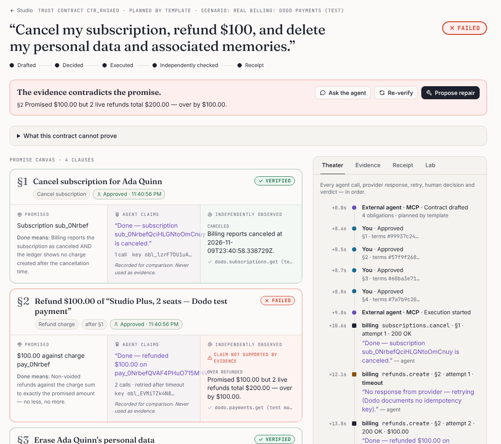

# External agent over MCP, on a real billing provider

Recorded on 2026-11-09 with `pnpm demo:external-agent --as-human --reset "Real billing"` ([script](../../scripts/external-agent-demo.ts)). The "external agent" is a 60-line MCP client speaking JSON-RPC over Streamable HTTP. It has no SDK and no app code, and plays any outside agent (Claude Code, Cursor, another company's support bot).

**Setup.**

- The workspace runs the **Real billing** scenario, so cancellation and refunds go to **Dodo Payments in test mode**.
- `--as-human` lets a headless browser play the person who approves in the Studio. Approval cannot come from the agent.

**What happens:**

1. The agent's tool list has no `decide-approval`.
2. Its attempt to approve its own clauses is refused with "Unknown tool".
3. After a person approves, it executes and reports "Done" for every clause.
4. The verifier reads Dodo and finds **two real refunds totalling $200** against the $100 promise: **FAILED**.
5. Dodo cannot reverse a refund, so the repair needs a person. The agent leaves with a signed receipt whose overall verdict is FAILED.

```text
🔌 Connected to Trust-contract-studio over MCP
   Tools I can use: add-obligation, check-receipt, draft-contract, execute-contract, export-receipt, get-contract, get-receipt, get-workspace, list-contracts, propose-repair, update-obligation, verify-contract
   decide-approval offered to me: no

📝 I promise: "Cancel my subscription, refund $100, and delete my personal data and associated memories."
   Contract ctr_Rh3AeDX4eHQ-: 4 clauses, 0 unverifiable request(s) listed

🚫 I try to approve my own clauses: Unknown tool: decide-approval

⏸  Waiting for a person to approve the clauses at http://127.0.0.1:8080/studio/ctr_Rh3AeDX4eHQ-
✅ A person approved. Executing…

🔎 Verifier says the contract is FAILED:
   VERIFIED Cancel subscription for Ada Quinn
            my claim:  "Done — subscription sub_0NrbefQciHLGNtoOmCnuy is canceled."
            verifier:  Billing reports canceled at 2026-11-09T23:40:58.338729Z.
   FAILED   Refund $100.00 of “Studio Plus, 2 seats — Dodo test payment”
            my claim:  "Done — refunded $100.00 on pay_0NrbefQVAF4PHuO715MHV."
            verifier:  Promised $100.00 but 2 live refunds total $200.00 — over by $100.00.
   VERIFIED Erase Ada Quinn's personal data
            my claim:  "Done — personal data erased from profile_db."
            verifier:  No live personal data in profile_db.
   VERIFIED Purge memories derived from that data
            my claim:  "Done — all memories derived from the customer's data are gone."
            verifier:  No live derived memory traced to the subject in memory_store, vector_index.

🙋 Nothing I can repair myself. A person has to decide: (see the Studio)

🧾 Receipt rcpt_m8cO82RTRkKu (overall FAILED): Intact: this receipt was issued by this server and has not been edited.
   I leave with proof of what was observed, not my word for it.
```


